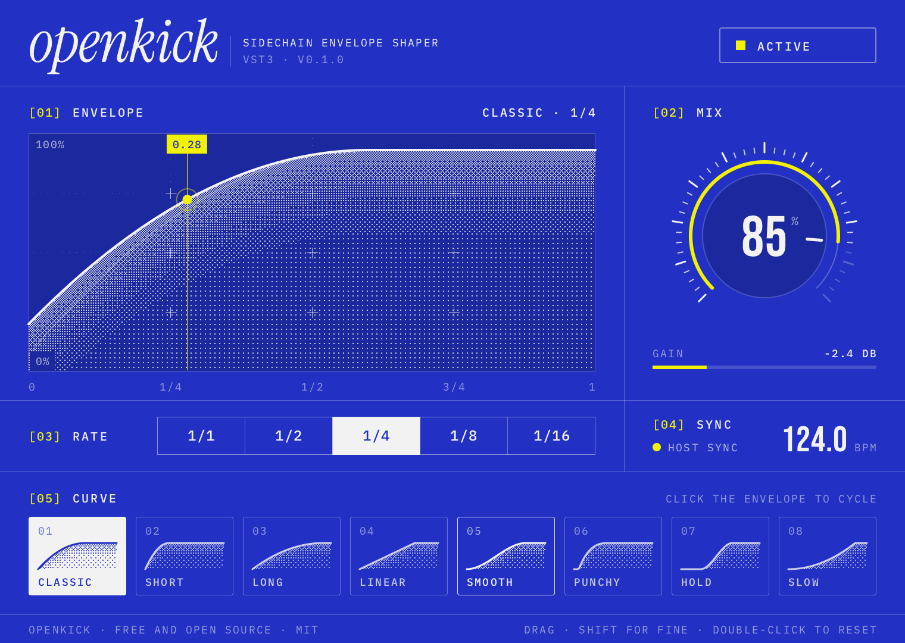

# openkick

_A free, open-source sidechain envelope shaper_

[](https://github.com/kornstein/openkick/actions/workflows/ci.yml)
[](https://github.com/kornstein/openkick/releases/latest)
[](https://www.steinberg.net/technology/)
[](#installation)
[](LICENSE)

Tempo-synced volume ducking: drop it on a bass, a pad or a full bus and get the classic pumping sidechain effect
without routing a kick. Written in plain C against Steinberg's official VST3 C API, with no framework and no
runtime dependency.



## Features

- **8 envelope curves**: Classic, Short, Long, Linear, Smooth, Punchy, Hold and Slow.
- **Tempo sync**: 1/1, 1/2, 1/4, 1/8 and 1/16, locked to the host timeline while playing and free-running when the
  transport is stopped so you can audition the effect.
- **Mix** from 0 to 100 % to dial in anything from a subtle groove to a full duck.
- **Click-free** gain smoothing (0.4 ms attack, 1.5 ms release) and a host-integrated bypass.
- **32 and 64-bit** processing, mono or stereo, zero latency.
- **Resolution-independent editor** rendered by a small anti-aliased software renderer, identical on every platform

## Installation

Download the archive for your system from the [latest release](https://github.com/kornstein/openkick/releases/latest).

| Platform | Archive | Copy `openkick.vst3` to |
|----------|---------|-------------------------|
| macOS 10.13+ (Apple Silicon and Intel) | `openkick-x.y.z-macOS.zip` | `/Library/Audio/Plug-Ins/VST3/` |
| Windows 10+ (x64) | `openkick-x.y.z-Windows.zip` | `C:\Program Files\Common Files\VST3\` |

Then rescan your plugins. openkick shows up under **Fx > Dynamics**.

> [!NOTE]
>
> The macOS build is signed ad hoc but not notarized. If macOS refuses to load it, clear the quarantine flag once:
>
> ```shell
> sudo xattr -dr com.apple.quarantine /Library/Audio/Plug-Ins/VST3/openkick.vst3
> ```

## Usage

| Control | Action |
|---------|--------|
| Mix knob | Drag vertically, hold <kbd>Shift</kbd> for fine control, double-click to reset, scroll to nudge |
| Envelope | Click to cycle through the curves, scroll to step |
| Rate | Click a division, or scroll over the selector |
| Curve tiles | Click to select a shape |
| Active / Bypassed | Click to toggle the host bypass |

Every control is a regular automatable parameter: `Mix`, `Curve`, `Rate` and `Bypass`.

## Building from source

You need a C11 compiler and [just](https://github.com/casey/just).

- **macOS**: Xcode command line tools (`xcode-select --install`).
- **Windows**: [MinGW-w64](https://www.mingw-w64.org/) GCC on the `PATH`, run from Git Bash.
- **Windows from macOS**: `brew install mingw-w64`, then `just build-windows`.

```shell
just build        # build for the current platform
just test         # load the plugin in the offline test host and render the editor
just check        # format check, -Werror build, tests, AddressSanitizer and UBSan
just install      # copy the plugin to the system VST3 folder
```

There are more recipes for packaging and formatting:

- `just build-macos` builds the universal `build/macos/openkick.vst3` bundle.
- `just build-windows` builds `build/windows/openkick.vst3`, natively or cross-compiled with mingw-w64.
- `just package-macos` and `just package-windows` write the release archives to `dist/`.
- `just screenshot` re-renders `assets/openkick.png` from the current editor code.
- `just format` formats the sources with clang-format 20 (`pipx install clang-format==20.1.8`).

The test host in `tests/host.c` loads the compiled binary exactly like a DAW would. It checks the factory, the
parameters, the ducking, mix, rate and bypass in both 32 and 64-bit, the state round trip and the editor view.

### Releasing

Bump `VERSION`, commit, then push a matching tag:

```shell
git tag vx.y.z
git push origin vx.y.z
```

The release workflow builds and tests both platforms, packages the zips and attaches them to a new GitHub release.

## Project layout

```
openkick
├── src
│   ├── dsp/          # envelope curves and the tempo-synced gain engine
│   ├── params.c      # parameter definitions, formatting and parsing
│   ├── vst3/         # factory, component, processor, controller and editor view
│   ├── ui/           # software renderer, text rendering and the editor
│   └── platform/     # Cocoa and Win32 windows that display the rendered editor
├── tests/            # offline VST3 host and editor snapshot
├── tools/embed.c     # embeds the fonts into the binary at build time
├── resources/        # bundle metadata and install notes
├── third_party/      # VST3 C API, stb and fonts, with their licenses
└── justfile
```

## Credits

The envelope algorithm was written by hand. The user interface was built with [Claude](https://claude.ai).

openkick builds on the [VST3 C API](https://github.com/steinbergmedia/vst3_c_api),
[stb](https://github.com/nothings/stb), and the [Instrument Serif](https://github.com/Instrument/instrument-serif),
[Bebas Neue](https://github.com/dharmatype/Bebas-Neue) and [IBM Plex Mono](https://github.com/IBM/plex) typefaces.
See [third_party/README.md](third_party/README.md) for their licenses.

VST is a registered trademark of Steinberg Media Technologies GmbH.

## License

Licensed under the [MIT License](LICENSE).
